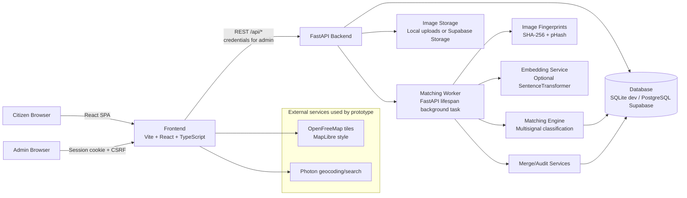
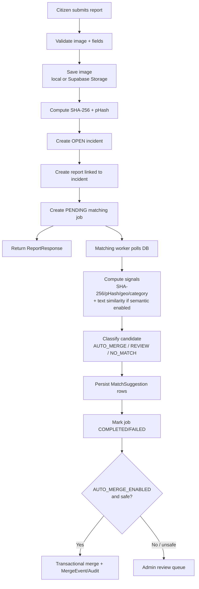
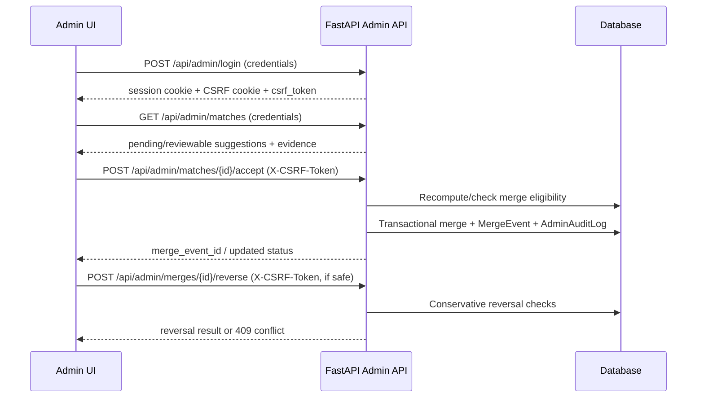

# StreetProof

StreetProof is an AI-assisted civic infrastructure issue intelligence platform prototype. Citizens can submit geo-located infrastructure reports with photos; the backend stores evidence, creates incidents, runs asynchronous duplicate detection, and gives admins a review workflow for potential matches, merges, and incident status updates.

> **Hackathon build:** developed for **PromptWars 2026 (10-Hour AI Prompting & App Building Hackathon, 25 November 2026, Siliguri Institute of Technology, West Bengal, India)**. This repository is a working MVP/prototype, not a production-certified civic platform.

## Table of Contents

- [Why StreetProof](#why-streetproof)
- [Indian Civic Context](#indian-civic-context)
- [What the Prototype Does](#what-the-prototype-does)
- [System Architecture](#system-architecture)
- [Core Workflows](#core-workflows)
- [AI / Duplicate Detection](#ai--duplicate-detection)
- [Tech Stack](#tech-stack)
- [Repository Structure](#repository-structure)
- [Environment Variables](#environment-variables)
- [Local Development](#local-development)
- [Database and Migrations](#database-and-migrations)
- [Testing](#testing)
- [Deployment Notes](#deployment-notes)
- [API Overview](#api-overview)
- [Security and Operational Notes](#security-and-operational-notes)
- [Known Limitations](#known-limitations)
- [Future Opportunities](#future-opportunities)
- [Facts / Information Not Verified](#facts--information-not-verified)

## Why StreetProof

Urban civic issue reporting often produces duplicate, incomplete, and hard-to-triage complaints. The same pothole, broken streetlight, garbage pile, or drainage issue can be reported multiple times by different people, while municipal systems need actionable, deduplicated incidents.

StreetProof focuses on that gap:

- **Citizens** submit a report with photo, category, description, and map location.
- **The system** preserves evidence, creates an incident, fingerprints the image, and queues matching.
- **AI-assisted matching** ranks possible duplicates using image and optional text/geo/category signals.
- **Humans stay in control**: uncertain matches go to admin review; merges create audit/merge records and can be conservatively reversed when safe.

## Indian Civic Context

The figures below are **context**, not claims that StreetProof is currently deployed in these systems.

| Source | Verified fact | Why it matters for StreetProof |
|---|---|---|
| World Bank, Urban population (% of total) - India (`SP.URB.TOTL.IN.ZS`, retrieved via World Bank API) | India urban population was **36.36% (2023)** and **36.87% (2024)** of total population. | A growing urban population increases pressure on municipal maintenance, complaint intake, and response workflows. |
| MoHUA Annual Report 2024-25, Swachhata App section | The report states **5.27 crore+ citizens** are using the Swachhata App and **over 5.14 crore complaints** have been resolved in the last 10 years; in FY 2024-25 (up to Dec 2024), **85,04,366 complaints** were received and **95%** resolved. | Large-scale citizen reporting already exists in India; duplicate detection and incident consolidation can improve triage quality. |
| DARPG CPGRAMS Annual Report 2024 | CPGRAMS is described as the Government of India's centralized public grievance platform, connected to states/UTs; in 2024, **11,62,185 grievances** were redressed by Central Ministries/Departments and **23,63,022 grievances** by States/UTs (as reported). | India has mature grievance-redress infrastructure; StreetProof is a prototype that explores AI-assisted duplicate/incident intelligence as a complementary capability. |
| NUDM Municipal Grievance Redressal Knowledge Standard (Jan 2024) | NUDM defines grievance-redress knowledge standards, including master data, complaint registration, status categories, escalation, and service-category models for municipal systems. | Future integration should align with municipal data standards and grievance workflows rather than replace them. |

**Design assumptions / future opportunities (not current integrations):** integration with municipal grievance portals, ward/ULB routing, citizen notification channels, and standardized municipal taxonomy. These are **not implemented** in this repo.

## What the Prototype Does

### Implemented

| Area | Capability | Implementation status | Notes |
|---|---|---|---|
| Citizen reporting | Submit report with image, description, category, latitude, longitude | Implemented | `POST /api/reports` multipart form; image required. |
| Citizen UI | Report form, image upload, map location picker, report list/detail pages | Implemented | React + MapLibre location picker; no map API key required. |
| Public incidents/map | Incident list/detail, map endpoint, interactive map with filters/legend/popups | Implemented | `/api/incidents`, `/api/incidents/map`, `/map`, Home map view. |
| Matching pipeline | Async DB-backed matching jobs and suggestions | Implemented | Worker polls pending jobs inside FastAPI lifespan. |
| Duplicate signals | SHA-256 exact image hash, perceptual hash, geo distance, category match, optional text embedding similarity | Implemented | Text similarity only in semantic mode; lightweight mode leaves it unavailable. |
| Admin auth | Login/logout/session, cookie-based auth, CSRF protection | Implemented | Signed session cookie + double-submit CSRF cookie/header. |
| Admin moderation | Dashboard, report/incident management, match review, accept/reject, merge history, conservative reversal | Implemented | Accept/reject/reverse are CSRF-protected mutating routes. |
| Database portability | SQLite dev default; PostgreSQL/Supabase-compatible config and Alembic migrations | Implemented | URL normalization to `postgresql+psycopg://`; migration head `g1b2c3d4e5f6`. |
| Image storage | Local filesystem or Supabase Storage backend | Implemented in code | `STORAGE_BACKEND=local|supabase`; production validation requires `supabase`. |

### Configured Off / Guarded by Design

| Area | Status | Notes |
|---|---|---|
| Automatic merge | Configured off by default | `AUTO_MERGE_ENABLED=false`. Admin can still accept a suggestion through merge service with safety checks. |
| Semantic matching in production | Default off unless explicitly enabled | `SEMANTIC_MATCHING_ENABLED` defaults to enabled in dev/test, disabled in production. Lightweight mode avoids torch/sentence-transformers load. |
| Production defaults | Guarded | Production validation rejects debug mode, missing/weak/default secrets/admin creds, wildcard CORS, missing CORS allowlist, and non-Supabase storage. |

### Not Implemented

- No Redis/Celery/distributed queue; worker is in-process.
- No production bucket auto-provisioning/policy management for Supabase Storage.
- No role-based admin permissions or audit-log UI.
- No automated browser E2E test suite in repo.
- No confirmed LICENSE file.

## System Architecture



## Core Workflows

### Report Submission and Matching



### Admin Match Review



## AI / Duplicate Detection

StreetProof uses a **multisignal, conservative** duplicate-detection pipeline. It does not auto-merge uncertain reports by default.

| Signal | Code path | Behavior |
|---|---|---|
| Exact image hash | `image_fingerprint.compute_sha256` | Strong evidence of identical image content. |
| Perceptual hash | `image_fingerprint.compute_phash`, Hamming/similarity | Detects visually similar images; thresholds configurable. |
| Geo distance | `geo.haversine_distance` | Uses report coordinates; missing/invalid coordinates block unsafe auto-merge. |
| Category match | Matching engine | Category disagreement prevents unsafe auto-merge. |
| Text similarity | `EmbeddingService` + cosine similarity | Only when semantic matching is enabled and model ready. Lightweight mode intentionally returns no fabricated text similarity. |

### Classification

`CandidateClassification` values:

- `AUTO_MERGE_CANDIDATE`
- `REVIEW_CANDIDATE`
- `NO_MATCH`

`MatchSuggestion.similarity_score` is a heuristic ranking score (0..1), not a calibrated probability.

### Safety/Operational Rules

- **No automatic merge on uncertain evidence.** `AUTO_MERGE_ENABLED` defaults to `false`.
- **Lightweight production mode:** when semantic matching is disabled, the backend must not import/load torch/sentence-transformers; `/api/health/ai` reports `status=disabled`.
- **Human moderation:** admin accept/reject endpoints require authenticated session and CSRF.
- **Merge integrity:** merge execution is transactional/idempotent, creates `MergeEvent` and `AdminAuditLog`, and preserves original reports/images.
- **Reversal:** merge reversal is conservative and refuses unsafe state changes.

## Tech Stack

| Layer | Technology | Repo evidence |
|---|---|---|
| Frontend | React 19, TypeScript, Vite 8, React Router 7, Tailwind CSS, Lucide React | `frontend/package.json` |
| Map/UI | MapLibre GL 6.19.0, OpenFreeMap Liberty style, Photon geocoding | `frontend/src/config/map.ts`, `frontend/src/components/IncidentMap.tsx`, `MapLibreLocationPicker.tsx` |
| Backend | FastAPI, SQLAlchemy 2, Pydantic/Pydantic Settings, Alembic | `backend/requirements.txt`, `backend/app/main.py` |
| Auth/Security | itsdangerous signed cookies, passlib[argon2], CSRF double-submit | `backend/app/auth/*`, `backend/app/config.py` |
| AI/Matching | Pillow, ImageHash, optional sentence-transformers + torch + scikit-learn | `backend/requirements.txt`, `backend/requirements-ai.txt`, `backend/app/services/*` |
| Data | SQLite default; PostgreSQL/Supabase compatible via psycopg | `backend/app/database.py`, `backend/app/config.py`, `backend/alembic/*` |
| Storage | Local upload dir or Supabase Storage public bucket | `backend/app/services/storage.py`, `backend/app/services/image_service.py` |

## Repository Structure

```text
StreetProof/
├── .env.example
├── .gitignore
├── AGENTS.md
├── README.md
├── start-streetproof.bat
├── backend/
│   ├── alembic/
│   ├── alembic.ini
│   ├── app/
│   │   ├── api/
│   │   ├── auth/
│   │   ├── services/
│   │   ├── config.py
│   │   ├── database.py
│   │   ├── main.py
│   │   ├── models.py
│   │   └── schemas.py
│   ├── pytest.ini
│   ├── requirements.txt
│   ├── requirements-ai.txt
│   ├── requirements-cpu.txt
│   ├── requirements-dev.txt
│   └── tests/
└── frontend/
    ├── .env.example
    ├── package.json
    ├── vercel.json
    ├── vite.config.ts
    └── src/
        ├── components/
        ├── config/
        ├── contexts/
        ├── hooks/
        ├── pages/
        └── services/
```

## Environment Variables

Use `.env.example` as the template. **Never commit real secrets, Supabase service-role keys, DB passwords, or admin credentials.**

### Backend (`backend/.env`)

| Variable | Default / example | Purpose / notes |
|---|---|---|
| `ENVIRONMENT` | `development` | `development`, `production`, or `test`. Production enables strict validation. |
| `DEBUG` | `true` | Must be `false` in production. |
| `CORS_ORIGINS` | localhost JSON array | Explicit allowlist; no `*` with credentials. Required in production. |
| `DATABASE_URL` | `sqlite:///./data/streetproof.db` | SQLite or PostgreSQL. `postgres://`/`postgresql://` normalized to `postgresql+psycopg://`. |
| `DATABASE_POOL_*` | pool defaults | PostgreSQL pool tuning. |
| `UPLOAD_DIR` | `./uploads` | Local image storage path. |
| `STORAGE_BACKEND` | `local` | `local` or `supabase`. Production requires `supabase`. |
| `SUPABASE_URL` | empty | Required when `STORAGE_BACKEND=supabase`. Backend only. |
| `SUPABASE_SERVICE_ROLE_KEY` | empty | Required when `STORAGE_BACKEND=supabase`. Backend only; never expose to frontend. |
| `SUPABASE_STORAGE_BUCKET` | `report-images` | Public bucket name for report images. |
| `SEMANTIC_MATCHING_ENABLED` | unset | `true`/`false` override; unset = enabled dev/test, disabled production. |
| `EMBEDDING_MODEL_NAME` | `sentence-transformers/all-MiniLM-L6-v2` | Semantic model name. |
| `EMBEDDING_MODEL_REVISION` | pinned SHA | Pinned model revision. |
| `EMBEDDING_CACHE_DIR` | `./model_cache` | Model cache location. |
| Matching thresholds | see `.env.example` | pHash/text/geo/merge thresholds and worker settings. |
| `AUTO_MERGE_ENABLED` | `false` | Keep off for conservative behavior. |
| `SECRET_KEY` | placeholder | Required strong/non-default in production (>=32 chars). |
| `ADMIN_USERNAME` / `ADMIN_PASSWORD` | placeholders | Required non-default/strong in production. |
| `ADMIN_COOKIE_SAMESITE` | unset | Default `none` in production, `lax` in dev/test; `none` requires Secure. |
| `ADMIN_SESSION_EXPIRE_MINUTES` | `60` | Session/CSRF cookie max-age basis. |
| `ADMIN_LOGIN_RATE_LIMIT*` | `5 / 60s` | In-memory per-process limiter. |

### Frontend (`frontend/.env`)

| Variable | Default | Purpose |
|---|---|---|
| `VITE_API_BASE_URL` | `http://localhost:8000` | Backend base URL for API calls. |
| `VITE_MAP_DEFAULT_LAT` | `26.7271` | Default map latitude. |
| `VITE_MAP_DEFAULT_LNG` | `88.3953` | Default map longitude. |
| `VITE_MAP_STYLE_URL` | OpenFreeMap Liberty | Optional map style override. |

## Local Development

### Prerequisites

- Python 3.12+ recommended
- Node.js 20+ recommended
- npm

### 1. Clone

```bash
git clone https://github.com/anugrhaswi/StreetProof.git
cd StreetProof
```

### 2. Backend

```powershell
Copy-Item .env.example backend\.env
cd backend
python -m venv venv
.\venv\Scripts\Activate.ps1
pip install -r requirements.txt
pip install -r requirements-dev.txt
alembic upgrade head
uvicorn app.main:app --reload --host 0.0.0.0 --port 8000
```

For full local semantic AI:

```powershell
pip install -r requirements-ai.txt
# optional CPU-only torch install flow: see backend/requirements-cpu.txt
```

Set `SEMANTIC_MATCHING_ENABLED=true` if you want to force semantic mode in dev.

### 3. Frontend

```powershell
cd frontend
Copy-Item .env.example .env
npm install
npm run dev
```

- Frontend: `http://localhost:5173`
- Backend: `http://localhost:8000`
- Vite proxies `/api` and `/uploads` to `http://localhost:8000`.

### 4. Windows convenience script

`start-streetproof.bat` starts backend/frontend in separate cmd windows, runs migrations, and uses the Vite dev server. Use it only after venv/node_modules are installed.

## Database and Migrations

- **SQLite local default:** `sqlite:///./data/streetproof.db`
- **PostgreSQL/Supabase:** set `DATABASE_URL` to a Postgres URL; app normalizes to `postgresql+psycopg://`.
- **Alembic:** config in `backend/alembic.ini`, env in `backend/alembic/env.py`.
- **Current migration head:** `g1b2c3d4e5f6`.

Common commands (from `backend/`):

```powershell
alembic upgrade head
alembic current
alembic history
```

The empty Supabase PostgreSQL project was migrated and verified during development (migration head reached). This does **not** prove production readiness, bucket policy correctness, or multi-instance deployment safety.

## Testing

### Verified in this workspace (previous runs)

| Command | Result | Notes |
|---|---|---|
| `PYTHONPATH=backend ENVIRONMENT=test DEBUG=true STORAGE_BACKEND=local pytest backend/tests/test_semantic_lightweight_mode.py -q --tb=short` | 6 passed | Lightweight semantic mode checks. |
| `PYTHONPATH=backend ENVIRONMENT=test DEBUG=true STORAGE_BACKEND=local pytest backend/tests -q --tb=short` | 107 passed, 1 skipped | Full backend suite at that point. |
| `npm --prefix frontend run build` | Passed | Vite build succeeded; chunk-size warning only. |
| `PYTHONPATH=backend ENVIRONMENT=test DEBUG=true STORAGE_BACKEND=local pytest backend/tests/test_admin_auth.py backend/tests/test_admin_reports.py backend/tests/test_production_config.py -q --tb=short` | 33 passed | After local uncommitted CSRF fix changes. |
| `PYTHONPATH=backend ENVIRONMENT=test DEBUG=true STORAGE_BACKEND=local pytest backend/tests -q --tb=short` | 119 passed, 1 skipped | After local uncommitted CSRF fix changes. |

### Run locally

Backend:

```powershell
cd backend
$env:PYTHONPATH='.'
$env:ENVIRONMENT='test'
$env:DEBUG='true'
$env:STORAGE_BACKEND='local'
pytest tests -q --tb=short
```

Frontend:

```powershell
cd frontend
npm run lint
npm run build
```

## Deployment Notes

### Current deployment shape

- **Frontend:** Vercel-style SPA build (`frontend/vercel.json` rewrites all routes to `index.html`).
- **Backend:** Render-style single FastAPI web service. No `render.yaml`/Dockerfile in repo.
- **Known deployment URLs used during development:** frontend `https://street-proof.vercel.app`, backend `https://streetproof-api.onrender.com`. Live availability/config was not re-verified from this CLI session.

### Production checklist (manual)

1. Set backend env vars/secrets in host platform (never commit): strong `SECRET_KEY`, non-default admin creds, `DEBUG=false`, `ENVIRONMENT=production`, explicit `CORS_ORIGINS`.
2. Use PostgreSQL/Supabase `DATABASE_URL` and run `alembic upgrade head`.
3. Set `STORAGE_BACKEND=supabase` with backend-only `SUPABASE_URL`, `SUPABASE_SERVICE_ROLE_KEY`, `SUPABASE_STORAGE_BUCKET`.
4. **Manually verify** Supabase bucket exists and public-read/object access matches expected behavior; code does not create/alter bucket policies.
5. Keep `SEMANTIC_MATCHING_ENABLED=false` for Render Free/lightweight mode unless you intentionally provision full AI deps/resources.
6. Redeploy frontend with correct `VITE_API_BASE_URL`.
7. Smoke-test cross-site auth: login, session refresh, CSRF-protected admin mutation, report image load.

## API Overview

Base URL: `http://localhost:8000` (local default)

### Public/Citizen

| Method | Path | Purpose |
|---|---|---|
| GET | `/api/health` | Service health. |
| GET | `/api/health/ai` | AI/semantic matching status. |
| POST | `/api/reports` | Create report (multipart: image, description, category, latitude, longitude). |
| GET | `/api/reports` | Paginated reports. |
| GET | `/api/reports/{report_id}` | Report detail. |
| GET | `/api/incidents` | Paginated incidents. |
| GET | `/api/incidents/map` | Map incidents (excludes merged). |
| GET | `/api/incidents/{incident_id}` | Incident detail. |
| GET | `/api/matching/reports/{report_id}` | Minimal public matching status. |

### Admin (session + CSRF for mutating routes)

| Method | Path | Purpose |
|---|---|---|
| POST | `/api/admin/login` | Login; sets cookies; returns `csrf_token`. |
| POST | `/api/admin/logout` | Logout; CSRF required. |
| GET | `/api/admin/session` | Session status; returns `csrf_token` when available. |
| GET | `/api/admin/dashboard/stats` | Dashboard stats. |
| GET | `/api/admin/dashboard/recent-reports` | Recent reports. |
| GET | `/api/admin/reports` | Admin report list/filter. |
| GET | `/api/admin/reports/{report_id}` | Admin report detail. |
| DELETE | `/api/admin/reports/{report_id}` | Delete report with safety checks; CSRF required. |
| GET | `/api/admin/incidents` | Admin incident list. |
| GET | `/api/admin/incidents/{incident_id}` | Admin incident detail. |
| PATCH | `/api/admin/incidents/{incident_id}/status` | Open/closed status update; CSRF required. |
| GET | `/api/admin/matches` | Match suggestion queue. |
| GET | `/api/admin/matches/{suggestion_id}` | Match suggestion detail. |
| POST | `/api/admin/matches/{suggestion_id}/accept` | Accept/merge; CSRF required. |
| POST | `/api/admin/matches/{suggestion_id}/reject` | Reject; CSRF required. |
| GET | `/api/admin/merges` | Merge event history. |
| GET | `/api/admin/merges/{merge_event_id}` | Merge event detail. |
| POST | `/api/admin/merges/{merge_event_id}/reverse` | Conservative reversal; CSRF required. |

## Security and Operational Notes

- **Secrets:** never commit `.env` files or keys. `.gitignore` ignores `.env*` and `backend/.env`.
- **CORS:** explicit allowlist with credentials; no wildcard origin.
- **Admin auth:** signed `HttpOnly` session cookie; JS-readable CSRF cookie; `X-CSRF-Token` required by `require_csrf`.
- **Cross-site deployment:** production defaults to `SameSite=None; Secure` for auth cookies; override only deliberately.
- **Rate limiting:** admin login limiter is in-memory per process, not distributed.
- **Image safety:** file type/size/content validation; image fingerprints computed before persistence.
- **Auditability:** merges/reversals/report deletions/status changes write admin audit records where implemented.
- **Data preservation:** merge operations preserve original reports and image evidence.

## Known Limitations

- **Uncommitted local CSRF hardening changes may exist in the working tree** (see git status before release). The README describes intended/current code behavior; verify final deployed commit.
- **No live browser/E2E QA in this CLI.** Map, mobile layout, console/runtime behavior, and deployed Vercel->Render flows need manual verification.
- **Single-process worker.** Matching worker runs in FastAPI lifespan; run one always-on instance or extract before horizontal scaling.
- **In-memory login rate limiter** is per process.
- **Supabase Storage bucket config not auto-verified.** Bucket existence/public-read policy must be checked manually.
- **Legacy local images on ephemeral filesystems** can be unavailable after restart/redeploy; records remain and UI should handle missing images.
- **No LICENSE file** in repository.
- **Not production-certified.** This is a hackathon prototype with security hardening, but municipal production deployment requires further review.

## Future Opportunities

Clearly **proposed / not implemented**:

- Municipal integration adapters for CPGRAMS/state grievance systems and ULB workflows.
- Ward/department routing, SLA tracking, escalation, and citizen notifications.
- Role-based access control, audit log UI, analytics dashboards.
- Distributed queue/worker, shared rate limiting, observability.
- Private/signed image access model and bucket policy automation.
- Multilingual citizen UX and accessibility audits.
- Field validation, dedupe explainability UI, and human feedback loop for matching thresholds.

## Facts / Information Not Verified

- Live deployment state of `https://street-proof.vercel.app` and `https://streetproof-api.onrender.com` at documentation time.
- Current Render/Vercel environment variable values, secret rotation status, and Supabase bucket public-read/policy configuration.
- Real cross-site browser behavior on deployed environments after any uncommitted local changes.
- End-to-end mobile/browser UI behavior, console errors, and accessibility in a live browser session.
- Whether the Supabase project used during development is the same project intended for future deployment.
- Production-scale performance/cost of semantic model loading on target hosting.
- Legal/license status for redistribution (no `LICENSE` file found).
- Team roster/ownership beyond repository remote metadata.

## Sources

- World Bank API, indicator `SP.URB.TOTL.IN.ZS` (India urban population %): https://api.worldbank.org/v2/country/IND/indicator/SP.URB.TOTL.IN.ZS?date=2023:2025&format=json
- MoHUA Annual Report 2024-25 (Swachhata App section): https://www.mohua.gov.in/upload/uploadfiles/files/MoHUA%20AR%2024-25_English.pdf
- DARPG CPGRAMS Annual Report 2024: https://darpg.gov.in/sites/default/files/CPGRAMS_Annual_Report_2024.pdf
- CPGRAMS portal: https://pgportal.gov.in/
- NUDM Municipal Grievance Redressal Knowledge Standard (Jan 2024): https://nudm.mohua.gov.in/wp-content/uploads/2024/01/2453.pdf
- StreetProof repository (remote): https://github.com/anugrhaswi/StreetProof.git
